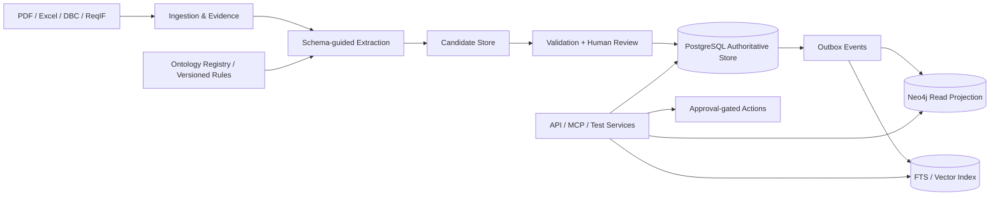

# 目标架构与系统边界（Architecture Decision Draft）

## 1. 业务能力

用户工作流：
1. 上传一版 PDF 式样书（同时指定项目/车型/市场/版本/权限）。
2. 浏览抽取的原文节、表格、原子需求和未对齐的实体。
3. 批量校验并人工审核，再发布指定 EngineeringBaseline 的知识。
4. 从功能/ECU/CAN 信号查询需求、跨式样关系和测试覆盖。
5. 对两版需求差异生成待审查影响范围及测试候选，不自动修改权威系统。

非功能要求：源文档完全保留、可恢复、幂等导入、有权限的逐字段审计、检索/推理可解释、数据库投影可重建、允许替换 LLM provider。

## 2. C4 式上下文



### 组件职责与禁止越界

| 组件 | 必须拥有 | 绝不能做 |
|---|---|---|
| Document Parser | layout、表格、Page/Section/BBox、内容 hash | 自动批准“事实” |
| Requirement Extractor | 原子化、条件、例外、证据候选 | 自造 CAN ID/ECU 权威标识 |
| Ontology Registry | 类、关系签名、属性类型、Schema 版本 | 存储运行时数百万事实 |
| Entity Resolver | 名称、别名、上下文、已有主数据候选 | 跨车型自动并号 |
| Validation | 类型/引用/基线/证据/时序规则 | 把 unknown 当 false |
| Review & Publication | 批量审批、不可变审计、发布基线 | 默默覆盖上一版 |
| Knowledge API | typed query、路径解释、访问过滤 | 任意 text-to-Cypher 写入 |
| Graph / Search Projection | 加速查询，带 build_version 与 watermark | 独立修改真实业务事实 |

## 3. 通信和一致性

- 统一主写路径：Application Command → Postgres transaction（实体状态/关系/审核/Outbox）→ 消费者重放到 Neo4j / Search。
- 投影以 `event_id` 幂等；`source_version + baseline_id` 作为水位。客户端可选择 `consistency=authoritative`（Postgres）或 `eventual`（索引）。
- 业务查询返回 `baseline_id, ontology_version, projection_watermark, evidence_anchors`，避免静默数据延迟。
- Neo4j 出故障时，权威库继续允许审查；依赖图查询标记 unavailable/stale，绝不偷偷返回不完整的影响结论。
- 不允许跨数据库分布式事务当作默认方案；要求 outbox 重放及投影对账机制。

## 4. 最小部署路线

**MVP（单机）**：FastAPI + PostgreSQL + Docling(Python) + 本地对象存储；先用 SQL 递归查询或关系 join + FTS，必要时用 PGVector。  
**Stage 2**：Neo4j + 投影 worker + 图查询 SDK。  
**Stage 3**：MCP Tool Server、测试观点规则引擎、变更审批；大规模再引入工作队列/分布式编排。

数据规模和 SLO 都是待测目标：例如验证 1k requirement、10k edge、10 个文档版本时的时延和索引正确性，不预设可以满足生产规模。

## 5. 组件替换接口

```text
DocumentParser.parse(file) -> DocumentStructure
RequirementExtractor.extract(sections, schema) -> CandidateFacts
EntityResolver.resolve(candidate, baseline, vocabulary) -> ResolvedCandidate
FactValidator.validate(candidate, schema, baseline) -> ValidationReport
KnowledgePublisher.publish(review_batch) -> Publication
GraphProjector.apply(outbox_event) -> Watermark
KnowledgeQuery.query(plan, baseline, principal) -> EvidenceBackedResult
```

LLM provider、Embedding provider、Graph engine 皆不可侵入权威实体和 Schema 契约。元数据字段要支持 batch id、model name、prompt version、tokens、费用、耗时、原因和 error class。

## 6. 与 Palantir Ontology 的“相似”和“不同”

相似：业务对象 / 关系 / 规则 / 受控 Actions / 权限作为统一数据模型。  
不同：不宣称复刻 Palantir Foundry/AIP 的私有执行、权限或工作流；本文使用开源 Postgres/Neo4j/LinkML 与自身 API。运行时安全边界是自己需要实现并验收的部分。

## 7. 开放议题

- 是否使用纯 Postgres 作为长期事实关系源？原则上是；引入图投影由 Stage 2 实测决定。
- 正式 Schema 先 LinkML，是否同时提供 OWL? 先验证 LinkML → JSON Schema + RDF 导出，OWL 导入作为可选。
- 物理权限建议使用 tenant/project/baseline + source confidentiality 标签；基于数据库 RLS 或服务授权统一测试，不能仅前端隐藏。
