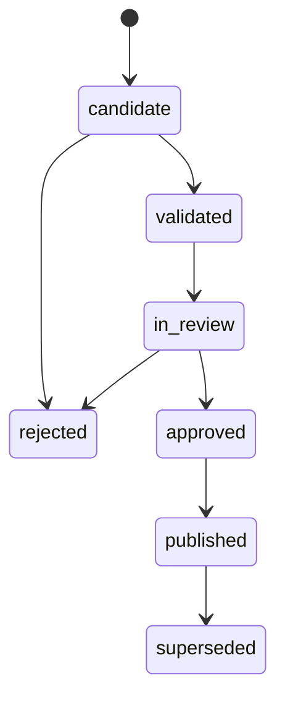

# 版本、工程基线、证据链与发布治理

## 1. 四种互相独立的版本

- **文档版本**：DocumentRevision 不可变，绑定 SHA-256、语言、文件存储 URI、页数/解析器版本。
- **产品适用性**：VehicleModel、Variant、Market、硬件/软件版本、选装特性。
- **语义模型版本**：Ontology Schema、规则版本、词表/VSS 版本。
- **事实/审核版本**：事实主记录、审查决策、变更请求、发布快照。

不要使用一个 `version` 字段混合所有维度。

## 2. EngineeringBaseline（单次查询的上下文）

```yaml
baseline_id: "695D-JP-2026Q4"
model: "695D"
market: "JP"
variant: "illustrative"
documents:
  SPEC-573: "2.1"
  HVAC_COMM: "1.5"
  C14: "3.0"
ontology_version: "0.1.0"
effective_from: null
release_status: draft
```

这里所有 code/rev 为**演示值**。正式 baseline 必须有唯一 ID、owner、审批日期和构成快照；已发布 baseline 不可直接修改组成，需创建 successor baseline。

## 3. 建议的数据血缘链

```text
SourceFile(bytes, sha256)
 -> DocumentRevision
 -> SourceAnchor(page, section, bbox, quoted_text)
 -> ExtractionRun(model, prompt, parser, timestamp)
 -> CandidateFact(confidence, unresolved_mentions)
 -> ValidationReport(schema/rule/version)
 -> ReviewDecision(actor, time, rationale)
 -> PublishedFact(entity/relation, baseline, source_anchors)
 -> GraphProjection(projection_version, watermark)
 -> QueryResponse(result + evidence + watermark)
```

最低审计字段：`created_at, created_by, parent_fact_id, extraction_run_id, prompt_hash, model_id, schema_version, source_anchor_id, reviewer_id, review_at, decision_reason`。

对于人工录入而非源文档抽取的关系，`origin=manual` 并记录人工说明/引用资料；不应冒充“出自 PDF”。

## 4. 如何安全处理版本差异

假设 Rev 2.1 = 1000ms，Rev 2.2 = 500ms：
- 存储原文两个 SourceAnchor；两版对应的 AtomicRequirementState。
- Stable logical ID 仅当经过规则/人审确认“同一逻辑需求”时复用。
- Diff 分类：ADDED、REMOVED、MODIFIED_TIMING、MODIFIED_CONDITION、MODIFIED_EXPECTED、APPLICABILITY_CHANGED、UNCERTAIN_ALIGNMENT。
- Compare API 返回 `old_baseline, new_baseline, changes[], linked_test_cases[], unresolved[]`。
- 测试影响路径是 **candidate**，除非工程规则确证，不应等价于“需要修改所有可达测试”。

## 5. 关系的有效性时间

优先以 **snapshot baseline** 作为一次完整、可复现的读取单位。必要时再加入双时间：
- valid_time：该要求或关系在业务上什么时候生效；
- transaction_time：数据库何时记录了这件事。

禁止通过覆盖旧记录模拟“更新”。审计采用 append-only，已发布事实标识 superseded 并引用 successor。

## 6. 原文证据粒度

- Text anchor：doc sha、物理 PDF 页码（与印刷页码另存）、section path、text span 和 digest。
- Table anchor：表格 ID、行列/单元格、合并单元格归属、page 与 bbox。
- Figure anchor：page、bbox、文字/图形解释来源；VLM 读图要带 uncertainty。
- Cross-document link：两个目标端各自的 source anchor，必要时加人工审核说明。
- Evidence must be resolvable：通过内部受控 URI 返回原文件片段；前端/LLM 不得泄漏未授权的图像或引用文本。

建议设计自动一致性检查：锚点 offset 对应的文本 hash、文档 SHA 与归档字节一致；schema/规则版本与构建记录一致；每个正式事实至少有一种有效证据来源。

## 7. 发布状态机



发布事务必须：校验基线未变、reviewer 有权限、已审批且 validator 通过、写入 outbox；退回理由写审计日志，不删除候选记录。

## 8. 风险

PDF 页码变化、日文 PDF 文本乱序、多版同名 Signal、DBC frame ID 扩展格式、手动修改通信信号、索引延迟，都可能制造“看似合理但不正确”的关系。解决不是提高 Prompt 温度，而是分层事实校验和证据门禁。
