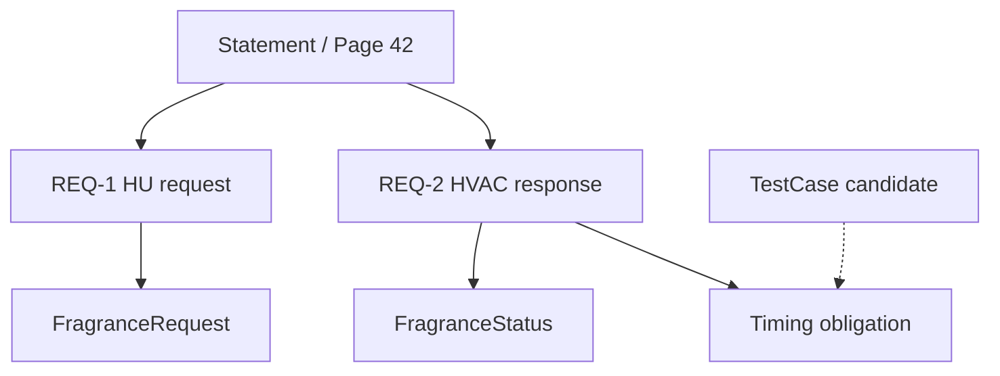

# 合成端到端案例：573 香氛 / 空调

> 本页所有业务值均为合成演示：车型 695D、文档 SPEC-573、信号 FragranceRequest/FragranceStatus、1000ms/500ms **不来源于真实 OEM 式样**，不得据此生成生产测试指令。

## 1. 假想 PDF

Rev 2.1 / Page 42 / §4.2.1：“车辆 READY 且 HVAC 开启时，用户开启香氛，HU 发送 FragranceRequest=1。HVAC ECU 收到请求后，应在 1000ms 内反馈 FragranceStatus=1。”

Rev 2.2：其他描述相同，反馈要求改为 500ms。

## 2. 规范性句子与两条 AtomicRequirement

```json
{
  "statement_id":"STMT:573:4.2.1",
  "source_anchor":{"doc":"SPEC-573","revision":"2.1","page":42,"section":"4.2.1"},
  "atomics":[
    {
      "id":"REQ:573:421:1",
      "actor":"HU",
      "preconditions":["PowerMode=READY","HVAC=ON"],
      "trigger":"UserEnableFragrance",
      "expected":"FragranceRequest=1"
    },
    {
      "id":"REQ:573:421:2",
      "actor":"HVAC ECU",
      "trigger":"FragranceRequest=1 received",
      "expected":"FragranceStatus=1",
      "max_delay_ms":1000,
      "reference_event":"request_received"
    }
  ],
  "review_required":true
}
```

注：第二条是否继承同一前置条件，需要按原文作用域复核。CAN 信号存在性、发送方/接收方和触发时刻都要参考真实 DBC/通信式样核实；仅凭 PDF 提取不能断言。

## 3. Entity Alignment

```text
ECU:695D:HU / ECU:695D:HVAC               (synthetic)
FEATURE:695D:Fragrance                    (synthetic)
SIGNAL:FragranceRequest                   (unresolved until DBC)
SIGNAL:FragranceStatus                    (unresolved until DBC)
REQ:573:421:1 / REQ:573:421:2             (candidates)
```

只有输入小型经授权的 DBC mock 并确认 Message/Signal/ECU 关系后，才能把 unresolved 信号变成 approved master data。

## 4. 关系及测试观点



| Obligation | 分类 | 判定 |
|---|---|---|
| 开关事件使 HU 发出请求 | trigger/output | 候选，待审 |
| 触发后状态反馈的时序 | timing | 候选，待审 |
| READY / HVAC ON 的适用状态 | condition | 候选，待审 |
| HU 与 HVAC ECU 的通信链 | cross-ECU | 候选，待审 |
| 请求丢失故障行为 | exception | **unknown**，原文未明确 |

## 5. Rev 2.1 → Rev 2.2 Impact

```json
{
 "old_baseline":"695D-JP-DEMO-R21",
 "new_baseline":"695D-JP-DEMO-R22",
 "field_change":{"req":"REQ:573:421:2","field":"max_delay_ms","old":1000,"new":500},
 "impact_candidates":[
   {"target":"TimingObligation","reason":"timing contract changed"},
   {"target":"TC-001","reason":"may verify timing behavior"}
 ],
 "requires_review":true
}
```

正确 UI 必须展示每条 impact path、源文档版本、引用文本和 reviewer status，而不仅列出图谱邻居。

## 6. 最小验收演示

上传两个合成 PDF + DBC mock；看到布局与两个原子需求；未知 Signal 明确 unresolved；审核后可按 Signal 找 Requirement 与 TestObligation；500ms 差分产生待审核的测试影响；Agent 不得不经批准修改正式测试系统。
